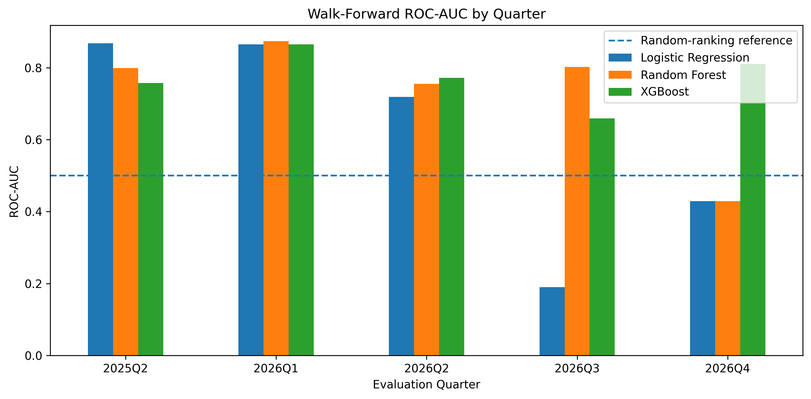
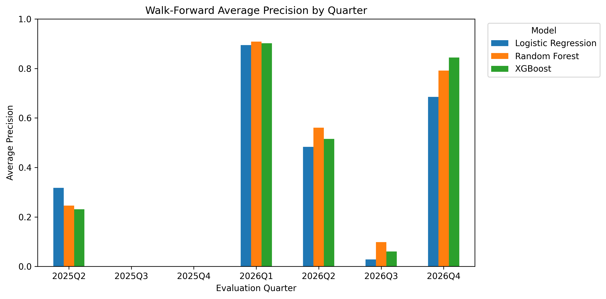

# Indian Equity Volatility Early-Warning Model

## Overview
This project investigates whether historical market data can help identify periods of elevated volatility in India's NIFTY 50 index over the next five trading sessions.

It compares three machine-learning approaches with a chronological walk-forward evaluation framework.

## Research Question
Can historical returns, rolling volatility, intraday price ranges, and volume-related indicators help rank upcoming high-volatility periods?

## Data
- **Market:** NIFTY 50 index (`^NSEI`)
- **Source:** Yahoo Finance via `yfinance`
- **Frequency:** Daily
- **Historical window:** Approximately 10 years, depending on data availability when the notebook is run.

## Target Definition
Future five-session volatility is calculated from the squared daily log returns over the next five trading sessions. A high-volatility event is defined as future volatility exceeding the 80th percentile of the training-period target distribution.

## Features
The selected eight features are:
- One-day log return
- Five-day return
- Twenty-day return
- Five-day rolling volatility
- Twenty-day rolling volatility
- Intraday high-low range
- Open-to-close return
- Volume change

## Models
- Logistic Regression
- Random Forest
- XGBoost

## Evaluation
The notebook uses chronological splits and expanding-window walk-forward evaluation. ROC-AUC and Average Precision are reported by evaluation quarter.

### Walk-Forward Evaluation Results

#### ROC-AUC by Quarter

#### Average Precision by Quarter

### Walk-Forward Summary

| Model | Mean ROC-AUC | Mean Average Precision |
|---|---:|---:|
| Logistic Regression | 0.614 | 0.484 |
| Random Forest | 0.732 | 0.505 |
| XGBoost | 0.773 | 0.542 |

These averages cover only five evaluated quarters. The quarters differ in sample size and event frequency, so the averages should be interpreted cautiously. Some quarters contain very few positive observations.

## Repository Contents
- `Indian_Equity_Volatility_Model.ipynb` — analysis, feature engineering, modelling, and evaluation.
- `results/walk_forward_results.csv` — quarterly model metrics.
- `results/model_performance_summary.csv` — descriptive summary across evaluated quarters.
- `results/walk_forward_auc.png` — quarterly ROC-AUC chart.
- `results/walk_forward_average_precision.png` — quarterly Average Precision chart.

## Limitations
- The study focuses on a single market index.
- Market regimes and the frequency of high-volatility events change over time.
- Metrics based on small quarterly samples are uncertain.
- Test-period results were inspected during development and are not an untouched final holdout.
- Predictive ranking does not establish profitability or demonstrate readiness for live trading.

## Reproducibility
Open the notebook in Google Colab and run its cells in order. The notebook installs its Python dependencies and retrieves historical data using `yfinance`. Results may change when the data source is updated.

## Disclaimer
This project is for educational and research purposes only. It is not financial advice or a trading recommendation.
